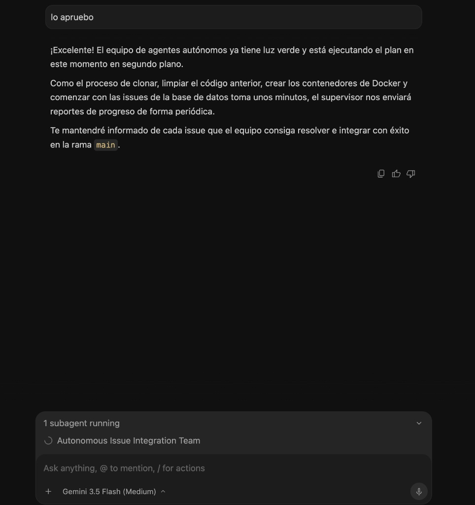
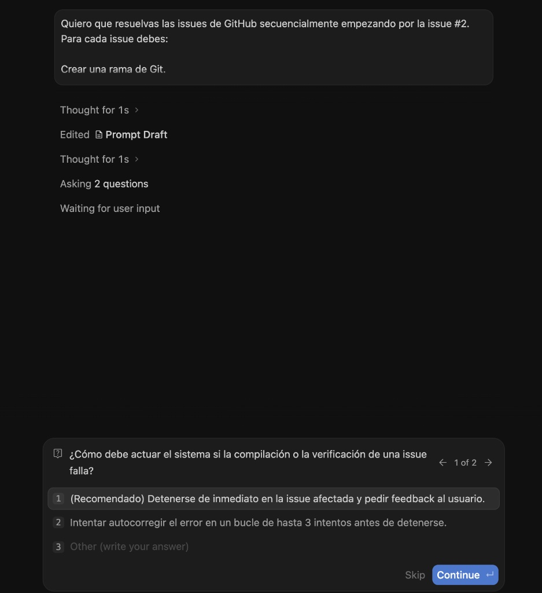
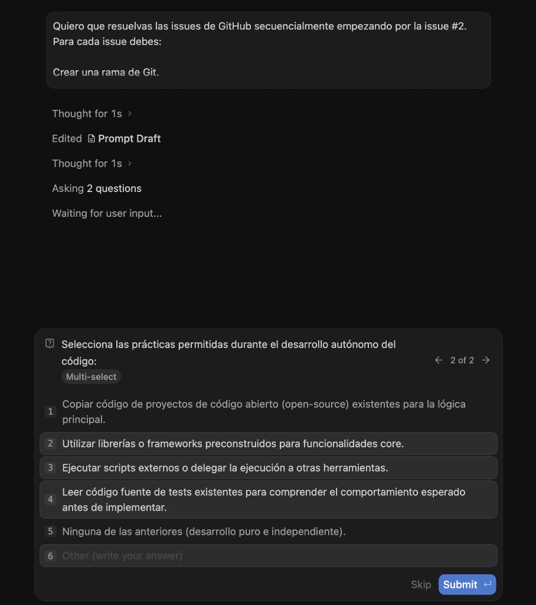

Hace unos meses empecé un proyecto para practicar inglés y prepararme para el B2/C1. Decidí que era el momento de rehacerlo desde cero (**Ceferly**), dockerizarlo y migrar el stack tecnológico a **React + Vite**, **Node.js con TypeScript**, **PostgreSQL** y **Prisma ORM**, usando **OpenRouter** como único proveedor de IA.

Para lograr que la IA desarrollara el proyecto por mí paso a paso y de manera autónoma, estructuramos el siguiente flujo de trabajo.

## 1. Gestión de Identidades Git sin fricción (SSH + `includeIf`)

En mi máquina local utilizo dos cuentas de Git. Para evitar conflictos al subir código y automatizar el cambio de identidad, divido mis proyectos en diferentes directorios y configuramos una regla **`includeIf`** en mi `~/.gitconfig` global.

De esta forma, cuando trabajo dentro de un directorio específico, Git aplica de forma automática la configuración asignada a esa carpeta, firmando los commits con la identidad correspondiente y usando la clave SSH correcta. ¡Cero configuraciones manuales a partir de ahí!

## 2. Control de GitHub desde la terminal (GitHub CLI)

Utilizando la CLI oficial de GitHub (`gh`) cambiamos la cuenta activa para el repositorio, lo cual nos permitió renombrar remotamente el repositorio de `quickgram` a `ceferly` en un solo comando:

```bash
gh repo rename ceferly -y
```

Tras renombrarlo, actualizamos la URL local al nuevo remoto SSH para mantener el canal seguro y evitar cualquier fricción de credenciales.

## 3. El secreto de la IA Agentica: Atomización en 60 Issues

Las IAs de desarrollo autónomo funcionan infinitamente mejor si las tareas son extremadamente pequeñas, concisas y acotadas (evitando que se saturen de contexto). Escribimos un script de automatización en **Python** que:
*   Creó en GitHub **las etiquetas personalizadas por colores** (`setup`, `backend`, `frontend`, `auth`, `database`, `ai`, `gamification`, `stripe`).
*   Pobló de forma masiva **60 issues granulares en inglés** en mi repositorio de GitHub, detallando para cada una el objetivo exacto, los requisitos mínimos y los archivos a modificar.

> "No le pidas a una IA que construya tu aplicación entera de golpe. El secreto está en desglosar tu visión en tareas atómicas y manejables."

## 4. Lanzamiento del Runner Autónomo (`/goal` + `/teamwork-preview`)

Para poner a trabajar a los agentes de IA de **Antigravity**, activamos los comandos de objetivos a largo plazo y orquestación multi-agente en el chat:



Se levantó un equipo colaborativo: un **Sentinel** supervisor, un **Orquestador** de tareas y **Desarrolladores** virtuales. El flujo autónomo de la IA para cada issue consiste en:

1.  Leer la issue de GitHub.
2.  Crear una rama de Git dedicada (ej: `feature/issue-3`).
3.  Implementar los archivos en local.
4.  Verificar que todo compila y conecta levantando el entorno completo con **Docker Compose** (`docker-compose up --build -d`).
5.  Hacer push a GitHub, abrir una Pull Request y mergearla automáticamente a `main` tras pasar los tests. Si falla, se detiene y me pide feedback.

Durante el proceso, el sistema me planteó preguntas clave para alinear decisiones, por ejemplo, cómo actuar ante fallos de compilación:



O la selección de prácticas de desarrollo permitidas:



## 5. Resiliencia ante caídas y autorrecuperación

Una de las características más sorprendentes de este flujo es la capacidad de resiliencia del orquestador. En un momento del desarrollo, se detectó una caída por un problema de red, y el subagente de control actuó de forma autónoma para restaurar el estado:


🚀 **Resultado**: La IA ya resolvió, testeó e integró de forma 100% autónoma la primera issue del repositorio (`[Setup] #1 - Configure root .gitignore`) abriendo y mergeando la PR #62 sin que yo tuviera que escribir una sola línea de código. 

Docker Compose valida de forma objetiva si el backend, frontend y base de datos compilan y se conectan correctamente antes de mergear, lo que convierte a Docker en el "árbitro" perfecto del desarrollo automatizado.
