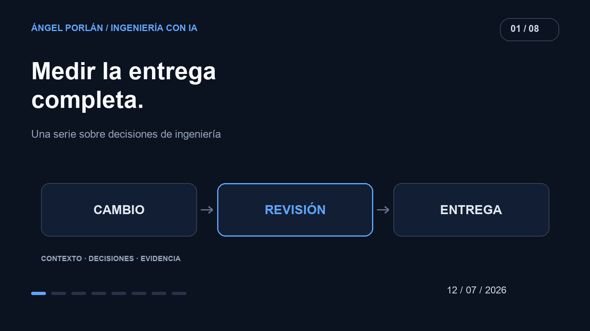

Después de poner varios agentes a trabajar, contar cambios se vuelve fácil. Entender si esos cambios acercan el producto a una entrega útil cuesta más. Una tarde puede dejar muchas ramas, varios pull requests y un problema original todavía abierto.

Mi siguiente pregunta después de experimentar con la orquestación fue cómo juzgar ese trabajo. Para mí, una mejora de productividad tiene que incluir lo que ocurre después de generar código: leerlo, probarlo, integrarlo y mantenerlo.

## La evidencia que abrió la conversación

Un [preprint publicado el 1 de julio](https://arxiv.org/abs/2607.01418v1) estudia la adopción de Claude Code y GitHub Copilot CLI en Microsoft. Los autores encuentran más pull requests fusionados entre quienes adoptaron las herramientas, y advierten que ese indicador no equivale al valor entregado.

Esa cautela es la parte que me interesa trasladar a un proyecto pequeño. Un resultado observado en una organización no demuestra cuánto he mejorado yo. Tampoco convierte el número de PRs en el objetivo de mi producto.

## Seguir una tarea completa

En [Ceferly](https://github.com/angelporlan/ceferly), el historial de principios de julio incluye configuración de Docker, variables de entorno, TypeScript y Prisma. Son piezas necesarias para construir, pero terminar cada una no equivale a entregar un flujo de aprendizaje al usuario.

Por eso separaría tres momentos al medir una tarea: cuándo se acepta el objetivo, cuándo existe un cambio revisable y cuándo el comportamiento queda integrado y comprobado. El intervalo entre los dos últimos deja ver trabajo que una demostración del agente puede ocultar.

Si una implementación tarda poco en generarse pero exige varias horas de corrección, esas horas pertenecen al mismo cambio. Si necesita que vuelva a explicar requisitos que ya estaban claros, esa fricción también cuenta.

## Un registro pequeño que sí podría mantener

No necesito empezar con un panel sofisticado. Este es el registro que usaría durante varias tareas comparables; es una propuesta de medición, no una tabla de resultados de mis proyectos.

| Señal | Qué anotaría | Qué permite detectar |
| --- | --- | --- |
| Tiempo hasta entrega | Inicio, revisión e integración | Esperas y trabajo posterior a generar código |
| Retrabajo | Correcciones tras la primera revisión | Requisitos omitidos o soluciones frágiles |
| Fallos | Regresiones y su impacto | Velocidad obtenida a costa de calidad |
| Coste | Uso del modelo y tiempo de supervisión | Tareas que no compensan la delegación |

Compararía cambios de tamaño y dificultad parecidos. No mezclaría corregir una etiqueta con diseñar una cola de trabajos. También conservaría los intentos fallidos: excluirlos haría que la herramienta pareciera más fiable de lo que fue.

## La revisión forma parte del presupuesto

Un cambio es más fácil de aceptar cuando puedo responder qué comportamiento modifica, qué evidencia lo respalda y cómo deshacerlo. Pedir eso al agente desde el principio reduce la distancia entre tener código y tener una propuesta que puedo evaluar.

Por ejemplo, una tarea podría pedir conservar una respuesta HTTP concreta, cubrir un caso de error y explicar la decisión en el PR. Esa definición permite revisar el resultado. La instrucción «mejora todo el backend» deja demasiado espacio para producir actividad sin un final comprobable.

No he ejecutado aquí un experimento controlado que justifique un porcentaje propio de mejora. Lo que sí puedo hacer es mantener una unidad de evaluación estable: una necesidad del producto resuelta, comprendida y verificada. Los commits y los tokens son señales auxiliares dentro de ese recorrido.

---

**Serie de ingeniería con IA · 1 de 8**

[← Artículo anterior](/blog/2026-06-28/como-automatice-orquestacion-agentes) · [Siguiente artículo →](/blog/2026-07-26/contexto-util-agents-skills)
