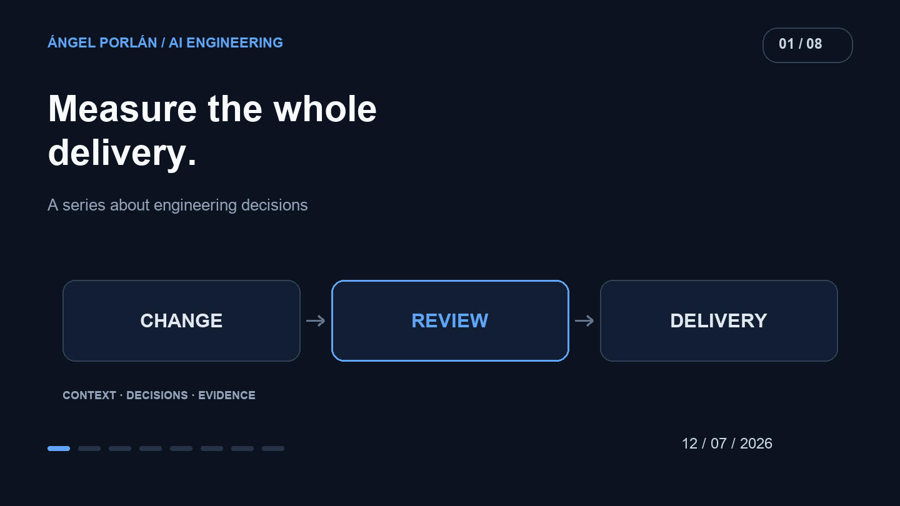

Once several agents are working, counting changes becomes easy. Establishing whether those changes move a product toward a useful delivery is harder. An afternoon can produce branches and pull requests while the original problem remains open.

After experimenting with orchestration, my next question was how to judge the work. A productivity improvement needs to include what happens after code generation: reading, testing, integration and maintenance.

## The evidence behind the question

A [preprint submitted on July 1](https://arxiv.org/abs/2607.01418v1) studies the adoption of Claude Code and GitHub Copilot CLI at Microsoft. Its authors find increased merged-pull-request output among adopters and acknowledge that this measure is different from delivered value.

That distinction matters in a small project. An observation at another organization does not establish my personal improvement. It also does not make PR count the purpose of my product.

## Follow a complete task

The early-July history of [Ceferly](https://github.com/angelporlan/ceferly) includes Docker setup, environment configuration, TypeScript and Prisma. These are necessary foundations, but finishing each piece does not amount to delivering a learning flow to a user.

I would therefore measure three moments: when a task is accepted, when a reviewable change exists, and when the behavior is integrated and checked. The gap between the last two exposes work that an agent demonstration can leave out.

If code takes minutes to generate and hours to correct, those hours belong to the same task. Repeatedly explaining requirements that were already clear is also part of its cost.

## A small record I could maintain

I would begin with the following record across comparable tasks. This is a measurement proposal, not a results table from my projects.

| Signal | What to record | What it helps reveal |
| --- | --- | --- |
| Time to delivery | Start, review and integration | Waiting and work after generation |
| Rework | Corrections after first review | Missing requirements or fragile solutions |
| Failures | Regressions and their impact | Speed gained at the expense of quality |
| Cost | Model usage and supervision time | Tasks that are poor delegation candidates |

Changes need comparable scope and difficulty. Fixing a label and designing a job queue should not share a single speed score. Failed attempts should stay in the record; dropping them would exaggerate reliability.

## Review belongs in the budget

A change is easier to accept when I can explain its behavior, identify its evidence and describe how to undo it. Asking the agent for those properties at the start narrows the distance between generated code and a proposal I can assess.

For example, a task might require preserving an HTTP response, exercising an error case and explaining the decision in its PR. That defines something reviewable. Asking for an improvement to the entire backend leaves too much room for activity without a verifiable finish.

I have not run a controlled experiment here that supports a personal percentage speedup. What I can establish is a consistent unit of assessment: a product need resolved, understood and checked. Commits and tokens are supporting signals along that path.

---

**AI engineering series · 1 of 8**

[← Previous article](/en/blog/2026-06-28/how-i-automated-agent-orchestration) · [Next article →](/en/blog/2026-07-26/useful-context-agents-skills)
