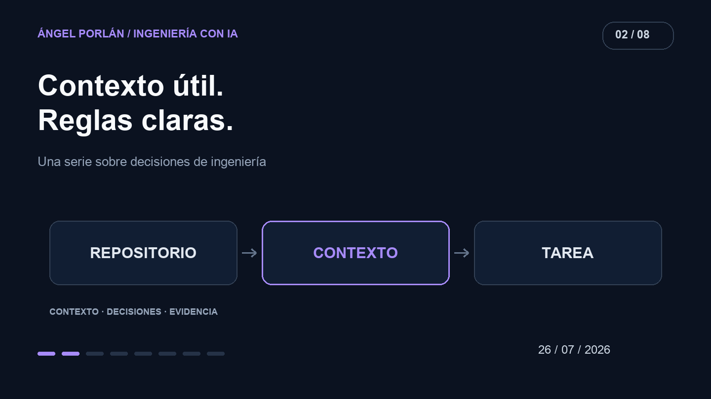

Cuando una IA interpreta mal una tarea, mi primera reacción puede ser añadir otra regla. Después otra excepción. Con el tiempo, las instrucciones acaban describiendo varias versiones del proyecto a la vez.

Quiero que el contexto ayude a encontrar la decisión correcta. Para eso necesita una estructura que yo también pueda mantener: qué es permanente, qué depende de la tarea y dónde está la evidencia actual.



## La noticia y su límite

El 24 de julio, el equipo de Claude Code publicó [cómo había reducido sus instrucciones de sistema](https://claude.dev/blog/the-new-rules-of-context-engineering-for-claude-5-generation-models/) para modelos más avanzados. El resultado pertenece a sus evaluaciones y a su producto; no demuestra que recortar cualquier archivo de instrucciones mejore cualquier agente.

Mi lectura práctica es revisar qué aporta cada bloque antes de seguir acumulándolo. Una regla que explica una restricción real tiene un propósito. Una que repite documentación antigua puede introducir una decisión equivocada en cada tarea.

## Tres capas de información

En el contexto estable pondría el propósito del producto, los límites que no se deben vulnerar y los comandos con los que comprobar el trabajo. Es información útil para casi cualquier cambio y suficientemente breve para revisarla cuando evoluciona el repositorio.

En las referencias dejaría arquitectura, contratos y decisiones extensas. El agente necesita saber dónde encontrarlas y cuándo leerlas. Copiarlas enteras en varios lugares crea otra obligación: mantener todas las copias de acuerdo.

La petición concreta contiene el objetivo de hoy, los casos de aceptación y los archivos o flujos afectados. Una preferencia temporal de una tarea no debería convertirse por accidente en una política permanente del proyecto.

## Un ejemplo de instrucciones revisables

Este bloque es ilustrativo; no reproduce el archivo real de Matchply:

```text
Propósito: adaptar CVs a ofertas de empleo.
Invariante: cada usuario solo accede a sus documentos.
Antes de cambiar un flujo: localizar su contrato y sus llamadores.
Comprobación: ejecutar los checks apropiados y mostrar la evidencia.
Si falta una decisión: explicar la duda antes de fijar una política nueva.
```

No intenta anticipar cada implementación. Indica qué necesita preservar el trabajo y dónde empieza una decisión que requiere contexto adicional.

Una skill puede guardar un procedimiento más específico: preparar un fixture, revisar un documento o comprobar un despliegue. Su descripción debería hacer reconocible el momento de usarla. También necesita entradas, límites y una condición observable de finalización. Si solo contiene consejos vagos, el nombre de la skill añade poco.

## Resolver contradicciones antes de medir tokens

Una instrucción puede mandar usar un servicio antiguo mientras otra describe su sustituto. El problema no es solo el tamaño del contexto: el agente recibe dos decisiones incompatibles.

Revisaría primero esas contradicciones. Después eliminaría duplicados y movería detalles a su fuente de verdad. Por último compararía el resultado con una tarea conocida desde el mismo estado del repositorio. Miraría si conserva el comportamiento, cuántas correcciones requiere y qué herramientas consulta.

Menos tokens sería una señal útil si la calidad se mantiene. Una respuesta más corta que omite un permiso o una comprobación importante sería un empeoramiento.

## Una obligación compartida

La documentación para agentes forma parte del mantenimiento. Si cambia el comando de pruebas o desaparece una ruta, actualizar su referencia evita que la siguiente tarea empiece siguiendo un mapa incorrecto.

Quiero poder leer mis instrucciones y reconocer el producto que existe. Esa es una comprobación sencilla antes de pedir a una IA que lo cambie.

---

**Serie de ingeniería con IA · 2 de 8**

[← Artículo anterior](/blog/2026-07-12/productividad-con-agentes) · [Siguiente artículo →](/blog/2026-08-09/mcp-herramientas-reales)
