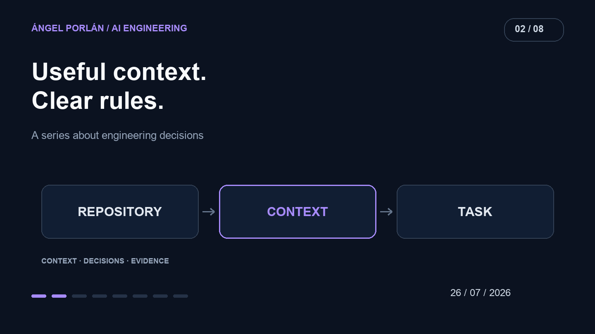

When an AI misinterprets a task, adding another rule is an easy reaction. Then comes an exception. Eventually the instructions describe several versions of the project at once.

I want context to help locate the right decision. That requires a structure I can maintain: what remains stable, what belongs to the current task, and where the up-to-date evidence lives.



## The announcement and its limits

On July 24, the Claude Code team published [how it reduced system instructions](https://claude.dev/blog/the-new-rules-of-context-engineering-for-claude-5-generation-models/) for more capable models. That result concerns its own evaluations and product; it does not establish that shortening every instruction file improves every agent.

My practical interpretation is to examine the contribution of each block before accumulating more. A rule describing a real constraint has a purpose. An outdated copy of documentation may introduce the wrong decision into every task.

## Three layers of information

Stable context should contain the product's purpose, its invariants and the commands used to check work. These are useful across changes and should remain short enough to revisit as the repository evolves.

References can hold architecture, contracts and lengthy decisions. The agent needs to know where to find them and when they matter. Copying them into several places creates an additional obligation: keeping every copy consistent.

The specific request supplies today's objective, acceptance cases and affected flows. A temporary preference for one task should not silently become permanent project policy.

## An example that can be reviewed

This is an illustrative block, not Matchply's actual instruction file:

```text
Purpose: adapt CVs to job offers.
Invariant: users can only access their own documents.
Before changing a flow: locate its contract and callers.
Verification: run appropriate checks and report the evidence.
If a decision is missing: explain the uncertainty before setting policy.
```

It does not predict every implementation. It identifies what the work must preserve and where additional context becomes necessary.

A skill can hold a narrower procedure: preparing a fixture, reviewing a document or checking a deployment. Its description should make the trigger recognizable. It also needs inputs, boundaries and an observable completion condition. A skill containing only vague advice adds little beyond its name.

## Resolve contradictions before counting tokens

One instruction might point to a retired service while another describes its replacement. The issue is larger than context size: the agent has been given incompatible decisions.

I would resolve those contradictions first, remove duplicates next and move details back to their authoritative references. Then I would compare a familiar task from the same repository state, checking preserved behavior, required corrections and tool use.

Lower token usage is useful when quality holds. A shorter answer that skips a permission or an essential check is a regression.

## Maintaining the map

Instructions for agents are part of maintenance. When a test command changes or a route disappears, updating its reference prevents the next task from following the wrong map.

I want to read the instructions and recognize the product that actually exists. That is a useful check before asking an AI to change it.

---

**AI engineering series · 2 of 8**

[← Previous article](/en/blog/2026-07-12/productivity-with-coding-agents) · [Next article →](/en/blog/2026-08-09/mcp-real-world-tools)
