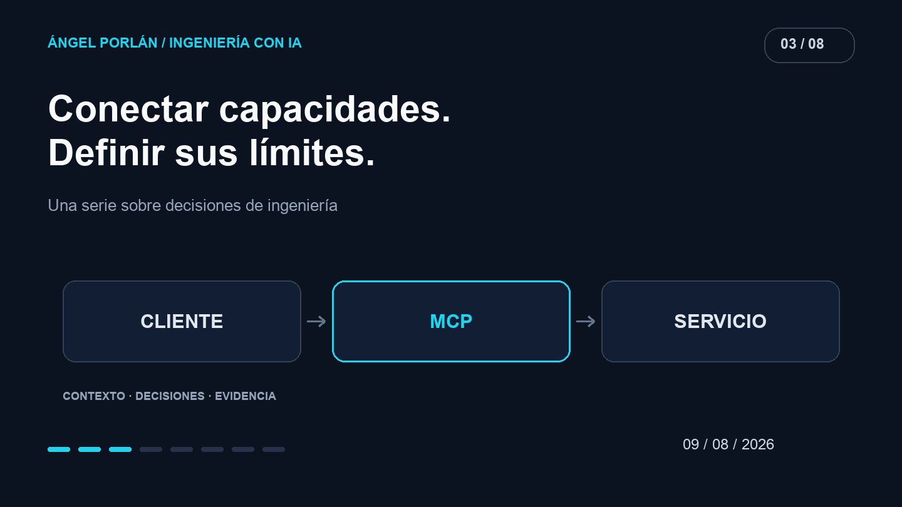

Un agente puede explicar qué haría con una candidatura. Para consultar sus datos o modificarla necesita una herramienta. Esa frontera me interesa más que una demostración en la que el modelo parece saberlo todo: ahí empiezan los permisos, los contratos y los errores del producto.

MCP ofrece una forma común de conectar esas capacidades. Adoptar el protocolo no termina el diseño de la integración; permite empezar desde un lenguaje compartido.



## Qué cambió el 28 de julio

La [revisión MCP 2026-07-28](https://modelcontextprotocol.io/specification/2026-07-28) y el [anuncio de su incorporación a Claude](https://claude.com/resources/articles/bringing-mcp-2026-07-28-to-claude) describen un núcleo sin estado, extensiones versionadas y cambios de autorización. Esto abre una conversación práctica sobre despliegue y compatibilidad, más allá de añadir otra herramienta al chat.

Mi interpretación arquitectónica es separar el estado necesario para una operación del estado de una conexión. Aunque el transporte no conserve una sesión de la misma forma, mi aplicación sigue necesitando identificar al usuario y saber sobre qué datos puede actuar.

## Diseñar una capacidad pequeña

Pensemos en una aplicación de candidaturas. Este es un ejemplo de diseño, no una API que esté anunciando como disponible en Matchply:

```text
Herramienta: consultar_candidatura
Entrada: identificador de candidatura
Salida: campos necesarios para responder a la tarea
Acceso: comprobar propiedad con el actor autenticado
Efectos: ninguno
```

La herramienta no recibe un texto libre que después se convierte en cualquier consulta. Tiene una operación reconocible y una salida que puedo documentar. Si el modelo pide un identificador ajeno, la comprobación del servicio debe seguir rechazándolo.

Para guardar una nota diseñaría otra capacidad, con su propio contrato. Mezclar lectura, modificación y envío de mensajes en una herramienta amplia hace más difícil saber qué se autoriza y qué se debe probar.

## El contexto puede contener instrucciones ajenas

Una descripción de oferta o una nota importada son datos que la aplicación necesita procesar. Pueden incluir una frase que intente dirigir al agente. El contenido no debe adquirir autoridad para ampliar el alcance de la herramienta.

Mi criterio de diseño sería que un documento nunca pudiera cambiar por sí mismo quién está autenticado, qué registros se permiten o qué efectos se han autorizado. Ese límite se comprueba en el código que ejecuta la operación.

También intentaría devolver solo la información necesaria para el objetivo. Una herramienta que lee una candidatura no necesita entregar todo el historial del usuario por comodidad.

## Compatibilidad antes de dar por hecha una migración

Una revisión nueva del protocolo no implica que todos los clientes, servidores y SDKs la soporten al mismo tiempo. Antes de cambiar una integración comprobaría las versiones de ambos extremos y sus capacidades concretas.

Después ejercitaría el contrato: una lectura permitida, una lectura rechazada, una entrada inválida y un fallo del servicio. Para escrituras añadiría reintentos y duplicados. Repetir una solicitud tras un corte no debería crear dos notas sin que el producto lo haya previsto.

Estas pruebas pertenecen a la integración que construya. El anuncio de un estándar no puede sustituirlas.

## Una integración que pueda explicar

La pregunta útil para mí es qué tarea del usuario mejora al conectar una herramienta. Si no puedo describir su entrada, su salida y su permiso, todavía no está suficientemente definida.

MCP puede reducir diferencias entre clientes. La responsabilidad sobre los datos y los efectos sigue en el servicio. Esa es la parte que quiero poder revisar antes de conectar un agente a un producto real.

---

**Serie de ingeniería con IA · 3 de 8**

[← Artículo anterior](/blog/2026-07-26/contexto-util-agents-skills) · [Siguiente artículo →](/blog/2026-08-23/nexo-leadon-experimento-crm-ia)
