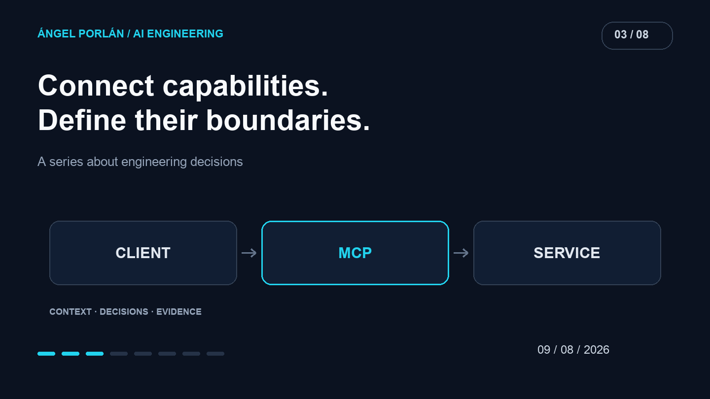

An agent can explain what it would do with a job application. Reading its data or changing it requires a tool. That boundary interests me more than a demonstration in which the model appears to know everything: it is where permissions, contracts and product errors begin.

MCP provides a common way to connect capabilities. Adopting the protocol does not finish the integration design; it provides a shared language to start from.



## What changed on July 28

The [MCP 2026-07-28 specification](https://modelcontextprotocol.io/specification/2026-07-28) and [Claude's support announcement](https://claude.com/resources/articles/bringing-mcp-2026-07-28-to-claude) describe a stateless core, versioned extensions and authorization changes. They raise practical questions about deployment and compatibility beyond adding another chat tool.

My architectural interpretation is to separate the state an operation needs from the state of a connection. A different transport lifecycle does not remove the application's need to identify the user and determine which records they may access.

## Design a small capability

Consider an application-tracking product. This is an illustrative design, not an announcement of an available Matchply API:

```text
Tool: read_application
Input: application identifier
Output: fields needed for the task
Access: check ownership using the authenticated actor
Effects: none
```

The tool does not accept arbitrary prose that becomes an unrestricted query. It has a recognizable operation and a documented result. A request for someone else's identifier must still be rejected by the service.

Saving a note would be a separate capability with its own contract. Combining reads, modifications and message sending in one broad tool makes authorization and verification harder to understand.

## Context can contain outside instructions

An imported job description or note is data the application needs to process. It can also contain text attempting to direct the agent. That content must not acquire authority to expand the tool's scope.

My design criterion is that a document cannot change the authenticated identity, allowed records or approved effects. The code executing the operation must enforce that boundary.

I would also return only the information required by the task. Reading one application does not require exposing a user's entire history for convenience.

## Check compatibility before assuming a migration

A new protocol revision does not mean every client, server and SDK supports it simultaneously. Before migrating, I would check versions and actual capabilities at both ends.

Then I would exercise the contract: an allowed read, a rejected read, invalid input and a service failure. Writes also need retries and duplicate requests considered. Repeating a request after a disconnect should not unexpectedly create two notes.

Those checks belong to the integration I build. A standards announcement cannot replace them.

## An integration I can explain

The useful question is which user task improves when a tool is connected. If I cannot describe its input, output and permission, the capability needs more design.

MCP can reduce differences between clients. Responsibility for data and effects remains with the service. That is the part I want to review before connecting an agent to a real product.

---

**AI engineering series · 3 of 8**

[← Previous article](/en/blog/2026-07-26/useful-context-agents-skills) · [Next article →](/en/blog/2026-08-23/nexo-leadon-crm-ai-experiment)
