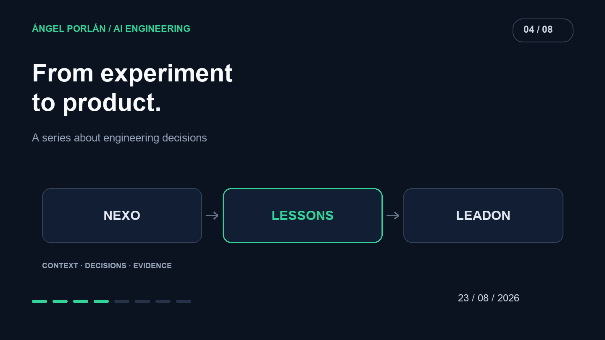

Nexo began as an experiment for ideas I would later take into LeadOn. I wanted to explore a CRM where AI could turn scattered information into something useful without requiring every field to be entered manually first.

**As this retrospective is published, LeadOn is already a paid AI CRM SaaS and its code is private.** That is the later state of the product. This August issue focuses on the Nexo experiment and what it can teach before building a commercial version.

## The experiment I can show

The [public Nexo repository](https://github.com/angelporlan/nexo-context-crm/tree/e6dcfc4c1fc2) documents a conversational CRM with customers, notes and questions about workspace information. Its extraction flow accepts pasted text, presents a proposed record and asks for confirmation before saving.

That review is a valuable boundary. A plausible response can contain a misread name, an invented relationship or a fact absent from the original text. A visible proposal lets the user inspect the suggestion before it becomes a record.

Nexo also documents answers with sources. Returning to an original note helps check an assertion and correct information. It does not make every answer true; it makes its basis inspectable.

## The application keeps responsibility

On August 19, OpenAI published [its approach to Codex as an embeddable platform](https://learn.chatgpt.com/blog/codex-as-a-platform). It separates agent execution from the application's context, rules and controls. This is an architectural reference, not a claim that Nexo or LeadOn uses that implementation.

In a CRM, the interface needs to show which customer is involved and what information will change. The service must determine whether the user may read or modify it. A model can propose a record; it should not independently decide its owner.

That division is more useful than hiding the entire product behind a chat box. Records, notes and confirmations carry meaning for the person managing a business relationship.

## What a prototype leaves unresolved

An experiment can rely on my knowledge of its limits. A product used by others must communicate them. If extraction fails, the original text should survive. If a proposal is unsaved, that state should be visible. If two customers might match, the ambiguity needs resolving.

These are design criteria I would carry into a product evaluation, not a disclosure of LeadOn's private implementation.

I would also separate a successful model call from successful user work. Receiving JSON does not establish that a record is correct. A successful database write does not establish that the person understood the change.

## Payment changes the responsibility

A paid SaaS needs understandable failure behavior, clear responsibility for data and reviewable consequential actions. AI expands what is possible while introducing mistakes that can appear persuasive.

This article discloses no commercial figures, customer data or private LeadOn code. Its contribution is the progression: using Nexo to explore an interaction, then distinguishing that exploration from the obligations of a product.

A useful test of an AI interface is whether a person can identify an incorrect proposal and correct it while staying in control. That is the prototype lesson I want to retain as the product develops.

---

**AI engineering series · 4 of 8**

[← Previous article](/en/blog/2026-08-09/mcp-real-world-tools) · [Next article →](/en/blog/2026-09-06/agents-tools-permissions)
