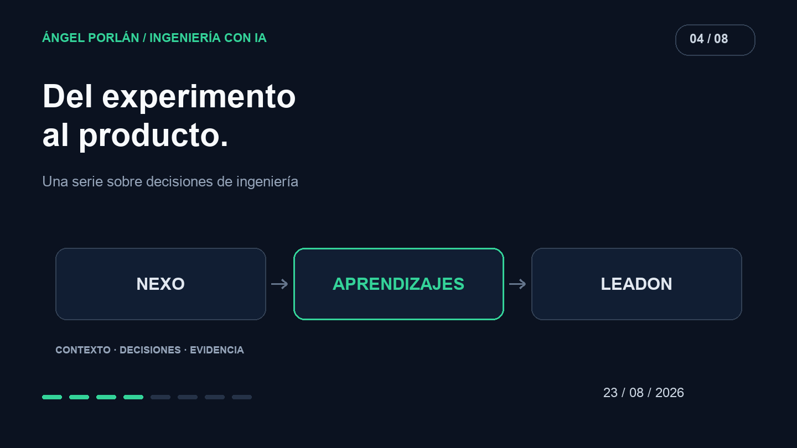

Nexo nació como una prueba para explorar ideas que después llevaría a LeadOn. Me interesaba un CRM en el que la IA ayudara a convertir información dispersa en algo útil, sin obligar a escribir primero cada campo de una ficha.

**Al recuperar esta serie, LeadOn ya es un SaaS de CRM con IA y usuarios de pago, y su código es privado.** Ese es el estado posterior del producto. Esta entrega de agosto se centra en el experimento Nexo y en lo que permite aprender antes de construir una versión comercial.

## La prueba que sí puedo mostrar

El [repositorio público de Nexo](https://github.com/angelporlan/nexo-context-crm/tree/e6dcfc4c1fc2) documenta un CRM conversacional: clientes, notas y preguntas sobre la información del espacio de trabajo. Su flujo de extracción permite pegar texto, revisar la ficha propuesta y confirmarla antes de guardarla.

Esa revisión me parece una frontera importante. Una respuesta plausible puede contener un nombre mal interpretado, una relación inexistente o un dato que no estaba en el texto. Mostrar una propuesta permite ver qué está sugiriendo el modelo antes de convertirla en un registro.

Nexo también documenta respuestas con fuentes. Poder volver a la nota de origen ayuda a comprobar una afirmación y a corregir información. No hace verdadera cualquier respuesta; hace posible inspeccionar su fundamento.

## La aplicación conserva la decisión

El 19 de agosto, OpenAI publicó [su planteamiento de Codex como plataforma integrable](https://learn.chatgpt.com/blog/codex-as-a-platform). El artículo separa el sistema que ejecuta el agente de la aplicación que aporta contexto, reglas y controles. Es una referencia arquitectónica; no significa que Nexo o LeadOn utilicen esa implementación.

En un CRM, la interfaz tiene que explicar sobre qué cliente se está trabajando y qué información va a cambiar. El servicio debe decidir si el usuario puede leerla o modificarla. El modelo puede proponer una ficha; no debería decidir por sí mismo a quién pertenece.

Ese reparto es más útil que esconder toda la aplicación detrás de un cuadro de chat. Una ficha, una nota y una confirmación tienen significado para la persona que está gestionando una relación comercial.

## Lo que un prototipo deja abierto

Una prueba puede tolerar que yo conozca sus límites. Un producto que usan otras personas necesita comunicarlos. Si una extracción falla, el usuario debe conservar su texto. Si una propuesta no está guardada, la interfaz debe indicarlo. Si hay dos posibles clientes, hace falta resolver la ambigüedad.

Estos son criterios de diseño que trasladaría del experimento a una evaluación de producto, no una lista de funciones internas que esté revelando sobre LeadOn.

También separaría el éxito de una llamada al modelo del éxito del trabajo del usuario. Obtener JSON no demuestra que la ficha sea correcta. Que el servidor acepte un registro no demuestra que la persona haya entendido qué cambió.

## Pagar cambia la responsabilidad

Un SaaS de pago exige que el comportamiento sea comprensible cuando algo falla, que los datos tengan un responsable claro y que las acciones importantes se puedan revisar. La IA añade posibilidades, pero también introduce nuevas formas de equivocarse con una apariencia convincente.

No publico aquí cifras comerciales, datos de clientes ni detalles del código privado de LeadOn. La aportación del artículo es el recorrido: usar Nexo para explorar una interacción y separar después esa exploración de las obligaciones de un producto.

La prueba más interesante de una interfaz con IA es que una persona pueda detectar una propuesta incorrecta y corregirla sin perder el control de su trabajo. Ese es el aprendizaje del prototipo que quiero conservar mientras el producto evoluciona.

---

**Serie de ingeniería con IA · 4 de 8**

[← Artículo anterior](/blog/2026-08-09/mcp-herramientas-reales) · [Siguiente artículo →](/blog/2026-09-06/agentes-herramientas-permisos)
