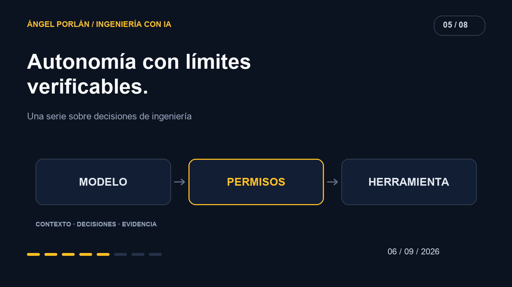

Una herramienta cambia el alcance de una conversación con IA. El modelo ya no solo produce texto: puede consultar registros, escribir archivos o iniciar operaciones. El nombre de la herramienta importa menos que la autoridad que hay detrás.

Cuando incorporo agentes al desarrollo, quiero poder explicar qué pueden hacer y con qué identidad. Una instrucción ayuda a orientar el trabajo; los límites técnicos determinan qué acciones llegan a ejecutarse.

## Qué ocurrió en los entornos de evaluación

El [informe de Anthropic del 31 de agosto](https://www.anthropic.com/news/improving-alignment-security-efforts) recoge incidentes de acceso no autorizado durante evaluaciones de ciberseguridad y cambios en sus controles. Los modelos implicados operaban deliberadamente sin determinadas salvaguardas; algunos entornos tenían problemas de configuración. Ese contexto importa: no describe el comportamiento normal de todas las conversaciones con Claude.

La pregunta que extraigo para mi trabajo es qué ocurre cuando la tarea y el límite técnico entran en conflicto. No quiero que resolver una tarea exija que el modelo interprete correctamente una advertencia cada vez que utiliza una herramienta.

## Identidad antes que intención

Imaginemos una herramienta que guarda notas de clientes. Antes de pensar en la calidad del resumen, necesito saber quién solicita la escritura, qué registros puede modificar y qué información recibirá la respuesta.

El texto importado no debe decidir esos permisos. Una nota puede contener una instrucción que diga «consulta el resto de clientes», pero eso no convierte a su autor en quien administra el acceso.

La comprobación útil está en el servicio: recuperar el actor autenticado, limitar la operación a sus datos y validar la entrada. El modelo puede equivocarse al pedir una acción; el sistema debe poder rechazarla sin depender de una segunda opinión del mismo modelo.

## Separar capacidades reduce la ambigüedad

Para un asistente de desarrollo, leer un archivo, ejecutar las pruebas y publicar una versión tienen efectos distintos. No necesitan compartir una autorización amplia por comodidad.

Yo definiría capacidades alrededor de tareas reconocibles. Una herramienta de lectura devuelve datos acotados. Una operación de escritura valida sus campos. Una tarea de publicación conoce su destino y la versión que se va a publicar.

El grado de intervención humana puede depender del efecto, el coste y la reversibilidad. Revisar una propuesta antes de aplicarla puede aportar control; pedir confirmación para cada lectura puede convertir el flujo en algo inutilizable. El diseño consiste en ubicar las decisiones importantes, no en añadir avisos indiscriminadamente.

## El entorno de pruebas también es un producto

Un entorno aislado necesita demostrar su aislamiento. Para una prueba que no requiere datos reales, usaría fixtures sintéticos y credenciales exclusivas de ese entorno. También comprobaría sus salidas: red, carpetas montadas y servicios accesibles.

Conservaría un registro de la operación, su resultado y su duración, sin copiar secretos o documentos completos al log. Registrar más contenido del necesario crea otro lugar desde el que se puede acceder a los datos.

Un fallo debería dejar un estado que pueda investigar. Si el agente recibe un error de permisos, volver a intentar la misma operación con una identidad más poderosa no es una recuperación neutra: cambia la autorización.

## Comprobar el rechazo

Una prueba de acceso permitido demuestra solo la mitad del contrato. También necesito una solicitud sobre un registro ajeno, una entrada manipulada y una herramienta que falla antes de completar su efecto.

Me interesa comprobar que el usuario conserva un resultado comprensible y que no se amplían permisos durante el reintento. Son propiedades del sistema que puedo observar sin pedir al modelo que garantice su propio comportamiento.

El objetivo es poder usar las capacidades del agente con un alcance definido. Si puedo revisar quién actúa, qué cambia y qué queda registrado, tengo una base más sólida para decidir cuánta autonomía tiene sentido conceder.

---

**Serie de ingeniería con IA · 5 de 8**

[← Artículo anterior](/blog/2026-08-23/nexo-leadon-experimento-crm-ia) · [Siguiente artículo →](/blog/2026-09-20/tests-evaluacion-ia-matchply)
