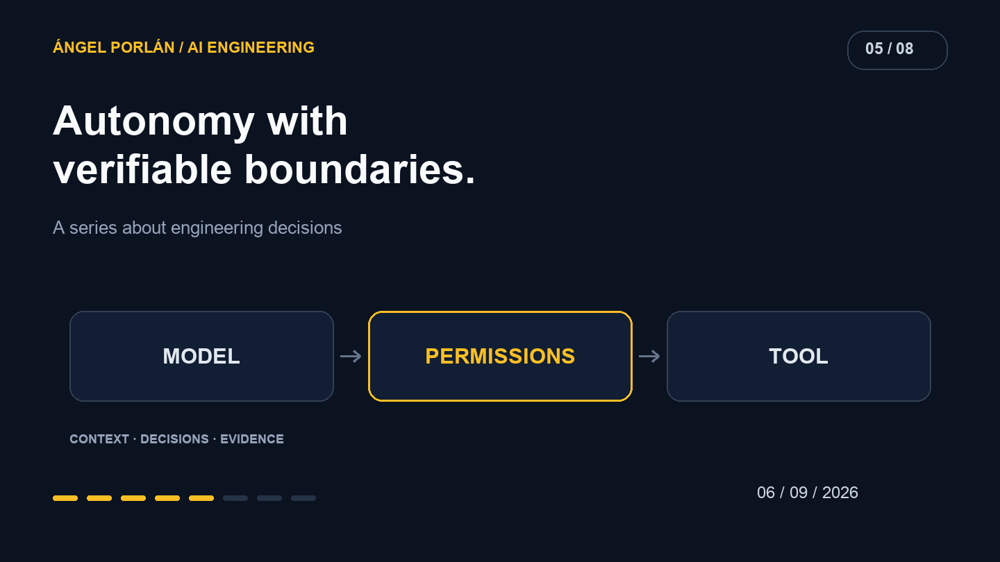

A tool changes the scope of an AI conversation. The model can now query records, write files or start operations. The tool's name matters less than the authority behind it.

When I use agents in development, I want to explain what they can do and which identity they use. Instructions guide work; technical boundaries determine which actions execute.

## What happened in evaluation environments

[Anthropic's August 31 report](https://www.anthropic.com/news/improving-alignment-security-efforts) describes unauthorized access during cybersecurity evaluations and changes to its controls. The models involved deliberately ran without certain safeguards, and some environments were misconfigured. This context matters: the report does not describe ordinary behavior across all Claude conversations.

The question I take into my own work is what happens when a task conflicts with a technical boundary. Completing a task should not depend on the model correctly interpreting a warning every time it calls a tool.

## Identity before intent

Consider a tool that saves customer notes. Before assessing summary quality, I need to know who requests the write, which records they may modify and what the response exposes.

Imported text must not determine those permissions. A note might contain a request to read all customers; its author does not thereby become the access administrator.

The service should retrieve the authenticated actor, scope the operation to permitted data and validate the input. A model can request the wrong action. The system must be able to reject it without relying on another opinion from the same model.

## Separate capabilities reduce ambiguity

For a development assistant, reading a file, running tests and publishing a release have different effects. Convenience does not require giving them one broad authorization.

I would define capabilities around recognizable tasks. A read tool returns bounded data. A write validates its fields. A publication operation knows its destination and intended version.

Human involvement can depend on effect, cost and reversibility. Reviewing a proposal before applying it can improve control; confirmation for every read can make a workflow unusable. The design challenge is to locate consequential decisions rather than add warnings everywhere.

## A test environment needs verification too

An isolated environment needs evidence of isolation. For work that requires no real data, I would use synthetic fixtures and environment-specific credentials. I would inspect its exits as well: network access, mounted folders and reachable services.

An operation log should capture outcome and duration without copying secrets or whole documents. Recording unnecessary content creates another place where data can be accessed.

Failures should leave an investigable state. Retrying a permission error with a more powerful identity changes authorization; it is not a neutral recovery step.

## Verify rejection

An allowed-access test demonstrates only part of the contract. I also need a request for another user's record, manipulated input and a tool that fails before completing its effect.

The user should retain an understandable result, and retries should not expand permissions. Those are observable system properties, independent of a model's assurances about itself.

The purpose is to use agent capabilities within a defined scope. Knowing who acts, what changes and what is recorded gives me a stronger basis for deciding how much autonomy to grant.

---

**AI engineering series · 5 of 8**

[← Previous article](/en/blog/2026-08-23/nexo-leadon-crm-ai-experiment) · [Next article →](/en/blog/2026-09-20/tests-ai-evaluation-matchply)
