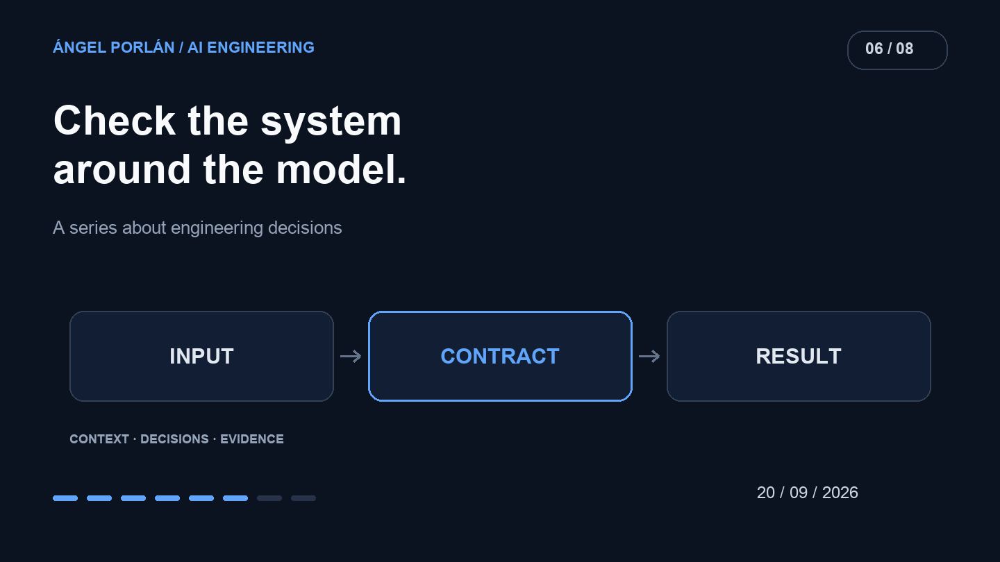

In Matchply, a persuasive AI response can become a score or a recommendation visible to the user. Compiling successfully does not establish that this transformation is correct.

This issue uses the [repository state of September 20](https://github.com/angelporlan/Matchply/tree/0eed07372330642fc6d0ff4c4bf83afeb6adbc33) as its reference. It describes checks already present by that date, separately from later improvements.

## A missing score is not an average score

The [matching-service tests](https://github.com/angelporlan/Matchply/blob/0eed07372330642fc6d0ff4c4bf83afeb6adbc33/scripts/matching-service.test.ts) replace model responses with controlled fixtures. Cases include missing dimensions, an empty batch and a valid score of zero.

The expected distinction matters: incomplete data is rejected while a legitimate zero survives. Inventing an intermediate score so the interface always has a number would hide the difference between an assessment and a failure.

The same file checks that a missing batch item preserves valid siblings and that persistence failures propagate. The task does not end when provider text arrives; what gets saved matters too.

## Explanation must not change the assessment

Another case checks that a quick assessment and its detailed explanation share the score. The explanation is generated from the existing result and reused when already available.

This protects a product property. Asking for detail should not silently trigger another assessment and produce a different number. The mock verifies sequencing and calls; it does not establish the quality of a real model's prose.

## Rules the application can verify

The [rubric tests](https://github.com/angelporlan/Matchply/blob/0eed07372330642fc6d0ff4c4bf83afeb6adbc33/scripts/matching-rubric.test.ts) cover fixed weights, score bands and workplace and salary constraints. They distinguish an offer below a declared salary minimum from an offer that provides no salary.

Unknown information should not become a demonstrated violation. Another case ensures that mixed remote-and-hybrid preferences are not interpreted as remote-only.

The [cache tests](https://github.com/angelporlan/Matchply/blob/0eed07372330642fc6d0ff4c4bf83afeb6adbc33/scripts/matching-cache.test.ts) exercise changes in sources, model and preferences. Service guards also reject stale writes. These checks protect against a result that was appropriate for an earlier input but no longer represents current data.

## What a model evaluation would need

A mock lets me trigger a specific failure. It does not estimate how often a real provider makes that mistake or whether it understands an ambiguous job description.

For that assessment, I would prepare synthetic CVs and offers with human-reviewed criteria. Clear cases, missing information and legitimately ambiguous requirements should be separate. Runs would retain their configuration and failures rather than only successful examples.

I would inspect format validity, grounding in the input and the usefulness of the explanation independently. Fluent writing does not compensate for invented candidate experience.

That describes an evaluation method I would add. I am not attributing a large live-model evaluation suite to September's repository when these tests do not establish one.

## Evidence with a defined scope

The existing tests check contracts and regressions in the system around the model. Live-model evaluation needs different evidence and has a different cost. Both are useful when their scope is clear.

I want a failure to be locatable: input, provider, validation, business rule or persistence. That separation makes it possible to fix a particular decision without assuming a well-written response has already passed every check.

---

**AI engineering series · 6 of 8**

[← Previous article](/en/blog/2026-09-06/agents-tools-permissions) · [Next article →](/en/blog/2026-10-04/choosing-model-cost-latency-quality)
