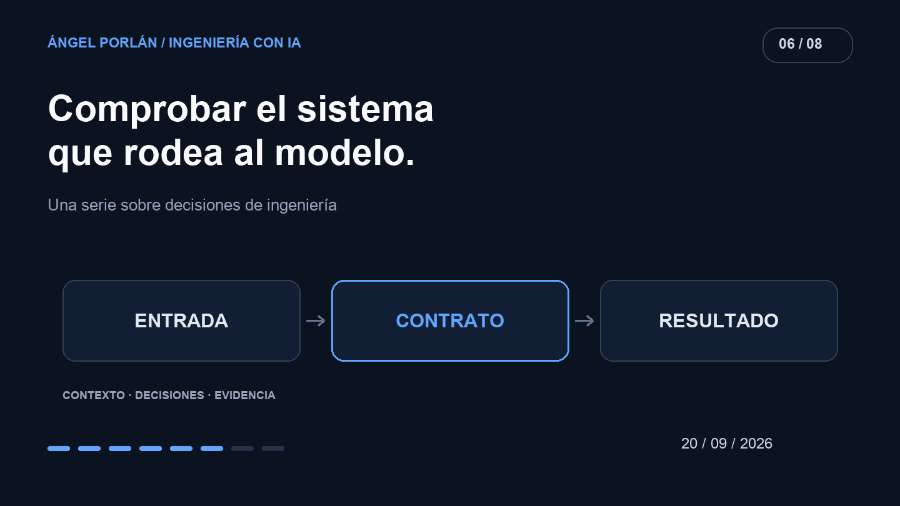

En Matchply, una respuesta convincente de la IA puede acabar convertida en una puntuación o en una recomendación visible para el usuario. Que el código compile no demuestra que esa transformación sea correcta.

Para esta entrega he tomado como referencia el [estado del repositorio del 20 de septiembre](https://github.com/angelporlan/Matchply/tree/0eed07372330642fc6d0ff4c4bf83afeb6adbc33). Así puedo hablar de comprobaciones que ya existían en esa fecha y distinguirlas de mejoras posteriores.

## Una puntuación ausente no es una puntuación media

Las [pruebas del servicio de matching](https://github.com/angelporlan/Matchply/blob/0eed07372330642fc6d0ff4c4bf83afeb6adbc33/scripts/matching-service.test.ts) sustituyen las respuestas del modelo por fixtures controlados. Entre sus casos aparecen una respuesta sin dimensiones, un lote vacío y una puntuación válida de cero.

El resultado esperado es importante: los datos incompletos se rechazan y el cero válido se conserva. Inventar un valor intermedio para que la interfaz siempre tenga algo que mostrar ocultaría la diferencia entre una evaluación y un fallo.

El mismo archivo comprueba que un elemento ausente en un lote no borre los resultados válidos de sus hermanos y que un error de persistencia se propague. La tarea no termina al recibir texto del proveedor: también importa qué llega a guardarse.

## La explicación no debe cambiar la evaluación

Otro caso verifica que la evaluación rápida y su explicación detallada compartan puntuación. La explicación se genera a partir del resultado y, cuando ya existe, se reutiliza.

Esto protege una propiedad del producto. Pedir más detalle no debería convertirse silenciosamente en repetir la evaluación y mostrar otra cifra. El test utiliza un modelo simulado para comprobar la secuencia y las llamadas; no demuestra por sí solo que la explicación redactada por un modelo real sea buena.

## Reglas que la aplicación puede comprobar

Las [pruebas de la rúbrica](https://github.com/angelporlan/Matchply/blob/0eed07372330642fc6d0ff4c4bf83afeb6adbc33/scripts/matching-rubric.test.ts) incluyen pesos fijos, bandas de puntuación y restricciones de modalidad y salario. Por ejemplo, distinguen una oferta por debajo del mínimo declarado de otra que no publica salario.

Ese matiz evita tratar información desconocida como un incumplimiento demostrado. También hay un caso para no interpretar una preferencia mixta, remoto e híbrido, como una exigencia exclusiva de remoto.

Las [pruebas de caché](https://github.com/angelporlan/Matchply/blob/0eed07372330642fc6d0ff4c4bf83afeb6adbc33/scripts/matching-cache.test.ts) comprueban cambios de fuentes, modelo y preferencias. Además, los guards del servicio rechazan escrituras obsoletas. Son defensas contra un resultado correcto para una entrada anterior que ya no representa la situación actual.

## Qué falta para llamar a esto una evaluación del modelo

Un mock permite provocar exactamente el error que quiero comprobar. No estima cuántas veces lo cometerá un proveedor real ni si sabe interpretar una oferta ambigua.

Para evaluar esa parte prepararía un conjunto de CVs y ofertas sintéticos con criterios revisados por una persona. Separaría casos claros, datos ausentes y requisitos que admiten varias interpretaciones. Repetiría ejecuciones con configuración registrada y conservaría también los fallos.

Revisaría por separado si la respuesta tiene el formato esperado, si sus afirmaciones se apoyan en la entrada y si la explicación ayuda a entender el resultado. La calidad de redacción no compensa inventar experiencia del candidato.

Esto describe una metodología que añadiría. No atribuyo al repositorio de septiembre una batería de evaluaciones masivas contra modelos reales que esos tests no acreditan.

## Evidencia con un alcance definido

Los tests existentes permiten comprobar contratos y regresiones del sistema que rodea al modelo. Una evaluación con llamadas reales necesita otras evidencias y tiene otro coste. Ambas piezas son útiles cuando se explica qué demuestra cada una.

Quiero que un fallo se pueda localizar: entrada, proveedor, validación, regla de negocio o persistencia. Esa separación permite corregir una decisión concreta sin confiar en que una respuesta bien escrita ya haya pasado todas las comprobaciones.

---

**Serie de ingeniería con IA · 6 de 8**

[← Artículo anterior](/blog/2026-09-06/agentes-herramientas-permisos) · [Siguiente artículo →](/blog/2026-10-04/elegir-modelo-coste-latencia-calidad)
