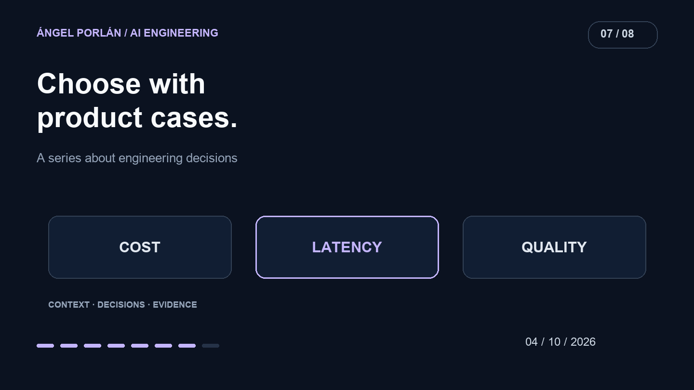

Every model release raises the same decision: whether the application should switch. A fast response in a chat does not answer that question for a product that validates data, generates explanations and handles failures.

In Matchply, I need to compare a complete task. Failed attempts and correction time are part of the cost of obtaining a useful result.

## What the launch establishes

Anthropic introduced [Sonnet 5.5 on September 28](https://www.anthropic.com/claude-sonnet-5-5), claiming speed and cost improvements over its predecessor. Those are the provider's claims and measurements. I have not performed a comparison here establishing the same percentages for Matchply.

The announcement is a reason to revisit a choice, not sufficient evidence for a production replacement.

## Record the actual comparison

Matchply's history includes a [configurable model catalog from September](https://github.com/angelporlan/Matchply/commit/37b1fdd96374f74a435e70fa0f2f76373ff7b3b6) and [cleanup of retired model references on October 2](https://github.com/angelporlan/Matchply/commit/f3e4e6666989539475ec6f7385fb0dcdcaa5dede). These are configuration and integration changes, not a public ranking of model quality.

For a comparison, I would record exact model identifier, provider, generation settings, prompt version and input. Changing the prompt between runs means I am no longer isolating the model change.

I would also distinguish an initial call from reused context or results. A warm cache can improve the journey without making the model itself faster.

## Cases should resemble product work

I would prepare synthetic CVs and offers covering sufficient evidence, unsupported requirements, incompatible conditions and missing fields. Every candidate would receive the same cases, with new examples added when failures appear.

The rubric would separate processable output, grounding in the input and explanatory usefulness. Valid JSON can contain a wrong conclusion. Persuasive prose can accompany an inconsistent score.

Manual review should precede choosing a threshold. An attractive average is unhelpful if it hides the failure that matters most to users.

## Three distinct measures

| Criterion | What I would measure | What to track separately |
| --- | --- | --- |
| Cost | Full cost per accepted task | Retries, caching and extra steps |
| Latency | Time until a usable result | Queueing, validation and persistence |
| Quality | Cases meeting reviewed criteria | Failure categories and concrete examples |

I would repeat runs. One excellent answer does not establish reliability; one slow answer may reflect a temporary condition. Conditions and failures belong alongside the result, without unsupported statistical precision from a small sample.

## A switch needs a way back

Migration must preserve the contract expected by consumers. Different fields or a changed expression of uncertainty require checking how the application reacts.

I would prepare a return to the previous configuration and observe errors after switching. A fallback needs its own evaluation: another model producing an answer does not establish equivalent behavior.

I want to justify a choice through product tasks and known costs. The right model for a short explanation may differ from the right one for a difficult assessment. Specific workflows can establish that distinction; a universal winner cannot.

---

**AI engineering series · 7 of 8**

[← Previous article](/en/blog/2026-09-20/tests-ai-evaluation-matchply) · [Next article →](/en/blog/2026-10-18/regaining-control-matchply-code)
