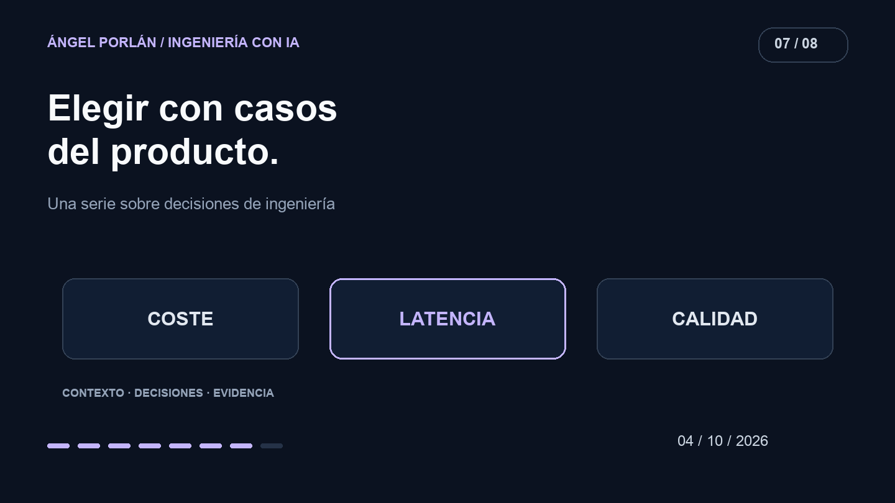

Cada lanzamiento de un modelo vuelve a plantear la misma decisión: si merece la pena cambiar el que usa mi aplicación. Una respuesta rápida en una conversación no resuelve esa pregunta para un producto que valida datos, genera explicaciones y debe manejar fallos.

En Matchply necesito comparar el resultado completo de una tarea. El coste de un intento fallido y el tiempo de corregirlo también forman parte de lo que pago por obtener un resultado útil.

## Lo que dice el lanzamiento

Anthropic presentó [Sonnet 5.5 el 28 de septiembre](https://www.anthropic.com/claude-sonnet-5-5) con mejoras de velocidad y coste frente a su versión anterior. Son resultados y afirmaciones del proveedor. No he ejecutado aquí una comparación que demuestre esos porcentajes en Matchply.

La noticia me sirve como motivo para revisar una elección, no como prueba suficiente para sustituir un modelo en producción.

## Registrar qué se está comparando

En el historial de Matchply hay un [catálogo configurable de modelos desde septiembre](https://github.com/angelporlan/Matchply/commit/37b1fdd96374f74a435e70fa0f2f76373ff7b3b6) y una [limpieza de referencias a modelos retirados el 2 de octubre](https://github.com/angelporlan/Matchply/commit/f3e4e6666989539475ec6f7385fb0dcdcaa5dede). Son cambios de configuración e integración; no equivalen a una clasificación pública de cuál es el mejor modelo.

Para hacer una comparación guardaría el identificador exacto del modelo, proveedor, opciones de generación, versión del prompt y datos de entrada. Si cambia el prompt entre pruebas, ya no estoy aislando el cambio de modelo.

También distinguiría una primera llamada de una con contexto o resultado reutilizado. Una caché caliente puede mejorar el recorrido sin que el modelo haya respondido más deprisa.

## El conjunto de casos debe parecerse al trabajo

Prepararía CVs y ofertas sintéticos con situaciones reconocibles: información suficiente, experiencia que no acredita un requisito, condiciones incompatibles y campos ausentes. Mantendría esos mismos casos para todos los candidatos y añadiría nuevos ejemplos cuando encontrase un fallo.

La rúbrica separaría tres preguntas: si la salida puede procesarse, si sus afirmaciones están apoyadas por la entrada y si la explicación ayuda a comprender la decisión. Un JSON válido puede contener una conclusión incorrecta. Una buena explicación puede acompañar una puntuación inconsistente.

Antes de elegir un umbral, revisaría ejemplos manualmente. No tendría sentido celebrar una media si oculta precisamente el tipo de error que más perjudica al usuario.

## Tres medidas que no conviene mezclar

| Criterio | Qué mediría | Qué conservaría aparte |
| --- | --- | --- |
| Coste | Coste completo por tarea aceptada | Reintentos, caché y pasos adicionales |
| Latencia | Tiempo hasta un resultado utilizable | Tiempo en cola, validación y persistencia |
| Calidad | Casos que cumplen los criterios revisados | Tipos de fallo y ejemplos concretos |

Repetiría las ejecuciones. Una única respuesta excelente no establece fiabilidad, y una única lenta puede reflejar una condición transitoria. Publicaría las condiciones y los fallos junto con el resultado, sin inventar precisión estadística con pocas muestras.

## Cambiar también necesita un plan de vuelta

Una migración debe conservar el contrato que esperan los consumidores del resultado. Si aparece un campo distinto o cambia la forma de expresar la incertidumbre, tengo que comprobar qué hará la aplicación con ello.

Prepararía una vuelta a la configuración anterior y observaría los errores tras el cambio. Un fallback requiere su propia evaluación: que otro modelo responda no garantiza que su salida sea equivalente.

Mi objetivo es poder justificar la elección con tareas del producto y un coste conocido. El modelo adecuado para una explicación breve puede no ser el adecuado para una evaluación difícil. Esa distinción se descubre comparando recorridos concretos, no escogiendo un ganador universal.

---

**Serie de ingeniería con IA · 7 de 8**

[← Artículo anterior](/blog/2026-09-20/tests-evaluacion-ia-matchply) · [Siguiente artículo →](/blog/2026-10-18/recuperar-control-codigo-matchply)
