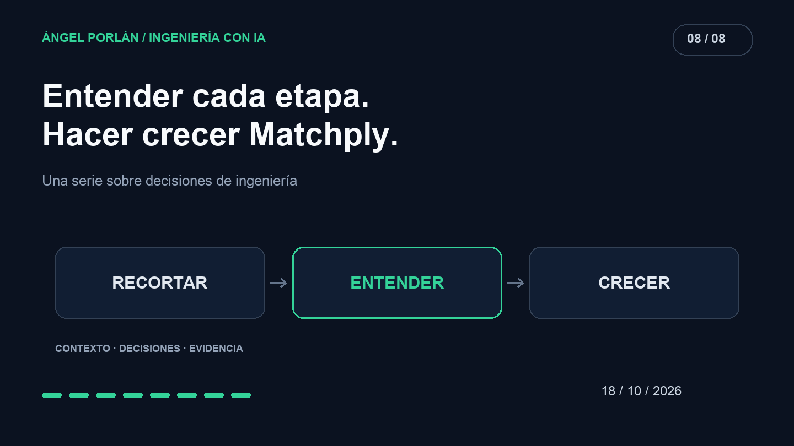

Matchply fue creciendo con ayuda de IA hasta que tuve que enfrentarme a una pregunta incómoda: cuánto del producto podía explicar sin pedir otra interpretación al agente.

Había código que no entendía lo suficiente para modificarlo con confianza. Empecé a recortar, simplificar y avanzar por etapas. Recuperar el control consistía en poder relacionar una necesidad del usuario con las piezas que la resolvían y con la evidencia de que seguían funcionando.

## Primero, saber qué estaba manteniendo

El [inventario funcional y las especificaciones añadidos en septiembre](https://github.com/angelporlan/Matchply/commit/89c1427) son una parte visible de ese proceso. Antes de seguir añadiendo funciones necesitaba distinguir los flujos que formaban el producto de las ideas que habían quedado alrededor.

Un inventario no tiene que describir cada línea. Tiene que ayudarme a localizar qué hace el usuario, dónde se ejecuta ese comportamiento y qué decisiones lo condicionan. Cuando no puedo encontrar esas relaciones, cualquier cambio pequeño empieza exigiendo investigar media aplicación.

La documentación también permite registrar una retirada como decisión de alcance. Borrar una funcionalidad cambia el producto; conviene explicar qué deja de ofrecerse y comprobar sus referencias.

## Recortar recorridos que añadían complejidad

El historial del 12 de septiembre muestra la retirada de las [páginas del método STAR](https://github.com/angelporlan/Matchply/commit/999a3f2) y sus [rutas y datos asociados](https://github.com/angelporlan/Matchply/commit/9742433). También aparece la [consolidación de plantillas PDF en Harvard](https://github.com/angelporlan/Matchply/commit/8eb6d26d4bdb7291e40eb652c09a0632c98d2b11).

Son cambios concretos de superficie y mantenimiento. Una familia de plantillas implica variantes que entender, probar y mantener coherentes con el editor. Reducir esa superficie me permitió concentrar el trabajo en un recorrido más definido.

El 27 de septiembre, otro cambio [concentró las candidaturas en la vista de tabla](https://github.com/angelporlan/Matchply/commit/46fdfaad0bb1b2e9eb8d706d785e91be6586989e) y retiró vistas anteriores. No deduzco de las líneas eliminadas un porcentaje de velocidad: la evidencia aquí es que había menos caminos de interfaz que mantener.

## Separar piezas para poder razonar sobre ellas

Simplificar no siempre consiste en eliminar funciones. El 29 de septiembre se [extrajeron el modelo de documento CV y su serialización](https://github.com/angelporlan/Matchply/commit/d24b3a005b1812ac73e3c03d2c63b019f0ce9571), acompañados de pruebas.

Esa separación da una pregunta más pequeña al revisar: cómo se representa un documento y cómo se transforma. La generación de PDF y la interfaz pueden apoyarse en esa pieza sin obligarme a entender ambos recorridos completos para inspeccionar una regla del documento.

No hay un tamaño mágico de archivo que garantice buen diseño. Me resulta más útil comprobar si puedo nombrar su responsabilidad, encontrar sus consumidores y predecir qué comportamiento debe mantenerse al cambiarlo.

## Volver a crecer con una etapa verificable

En octubre, la optimización de CVs con variantes tuvo [requisitos y expectativas previos](https://github.com/angelporlan/Matchply/commit/593c0ec) y después [pruebas específicas](https://github.com/angelporlan/Matchply/commit/bf0586b). Es una forma de avanzar que deja más puntos de apoyo para revisar el siguiente cambio.

Para una etapa quiero poder explicar su entrada, su resultado, sus efectos sobre datos y sus fallos relevantes. Después puedo revisar su implementación y ejecutar las comprobaciones que correspondan. Acumular funcionalidades antes de entender esas propiedades volvería a ampliar la misma distancia.

## El agente también puede ayudar a mantener

El 14 de octubre, OpenAI publicó [cómo utiliza agentes para mantenimiento de software](https://learn.chatgpt.com/blog/maintaining-software-with-the-gpt-6-family). Es un ejemplo externo de investigación de código sin uso y preparación de cambios revisables. Sus cifras pertenecen a sus proyectos, no a Matchply.

Mi experiencia la puedo sostener con decisiones más pequeñas: quitar una función, consolidar una vista, separar una representación y comprobar el siguiente paso. La IA sigue formando parte del trabajo. Lo que ha cambiado es el criterio con el que acepto su resultado: necesito poder explicar qué hace, por qué está ahí y cómo comprobarlo.

---

**Serie de ingeniería con IA · 8 de 8**

[← Artículo anterior](/blog/2026-10-04/elegir-modelo-coste-latencia-calidad) · [Siguiente artículo →](/blog/2026-10-22/rendimiento-matchply-antes-despues)
