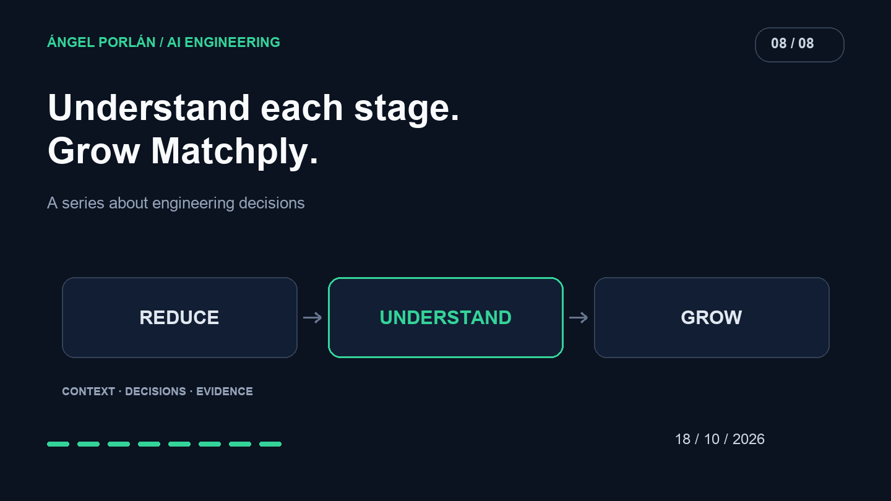

Matchply grew with AI assistance until I had to face an uncomfortable question: how much of the product could I explain without asking the agent for another interpretation?

Some code was beyond what I understood well enough to change confidently. I began removing, simplifying and progressing in stages. Regaining control meant connecting a user need to the pieces implementing it and to evidence that they still worked.

## Know what I am maintaining

The [functional inventory and specifications added in September](https://github.com/angelporlan/Matchply/commit/89c1427) are visible parts of that process. Before adding more functionality, I needed to distinguish the product's working flows from ideas accumulated around it.

An inventory does not need to describe every line. It should locate user behavior, its implementation and the decisions shaping it. When those relationships are hard to find, a small change starts by requiring an investigation across the application.

Documentation also records removal as a scope decision. Retiring a feature changes the product; its consequences and remaining references need checking.

## Reduce paths that add complexity

On September 12, the history records removal of the [STAR-method pages](https://github.com/angelporlan/Matchply/commit/999a3f2) and their [related routes and data](https://github.com/angelporlan/Matchply/commit/9742433). It also records [consolidation of PDF templates into Harvard](https://github.com/angelporlan/Matchply/commit/8eb6d26d4bdb7291e40eb652c09a0632c98d2b11).

These are concrete changes in product and maintenance surface. A template family creates variants to understand, test and keep consistent with the editor. A smaller surface let me focus work on a more defined path.

On September 27, another change [consolidated applications into the table view](https://github.com/angelporlan/Matchply/commit/46fdfaad0bb1b2e9eb8d706d785e91be6586989e), removing previous views. Deleted lines do not establish a percentage speedup. The evidence here is fewer interface paths to maintain.

## Separate pieces I can reason about

Simplification does not always require removing features. On September 29, the [CV document model and serialization were extracted](https://github.com/angelporlan/Matchply/commit/d24b3a005b1812ac73e3c03d2c63b019f0ce9571), with accompanying tests.

That creates a narrower review question: how a document is represented and transformed. PDF generation and the interface can use the same piece without requiring both complete paths to inspect one document rule.

No magic file size guarantees good design. A more useful check is whether I can name a responsibility, locate its consumers and predict which behavior must survive a change.

## Grow through verifiable stages

In October, CV optimization with variants had [requirements and expectations first](https://github.com/angelporlan/Matchply/commit/593c0ec), followed by [specific tests](https://github.com/angelporlan/Matchply/commit/bf0586b). That progression leaves evidence to support reviewing the next change.

For a stage, I want to explain its input, output, data effects and relevant failures. Then I can inspect its implementation and run appropriate checks. Accumulating more features before understanding those properties would recreate the same distance.

## Agents can help maintain software too

On October 14, OpenAI published [its use of agents for software maintenance](https://learn.chatgpt.com/blog/maintaining-software-with-the-gpt-6-family). It provides an external example of investigating unused code and preparing reviewable changes. Its measurements belong to its own projects, not Matchply.

My experience rests on smaller decisions: retiring a feature, consolidating a view, separating a representation and checking the next step. AI remains part of the work. The acceptance criterion has changed: I need to explain what the result does, why it exists and how to verify it.

---

**AI engineering series · 8 of 8**

[← Previous article](/en/blog/2026-10-04/choosing-model-cost-latency-quality) · [Next article →](/en/blog/2026-10-22/matchply-performance-before-after)
