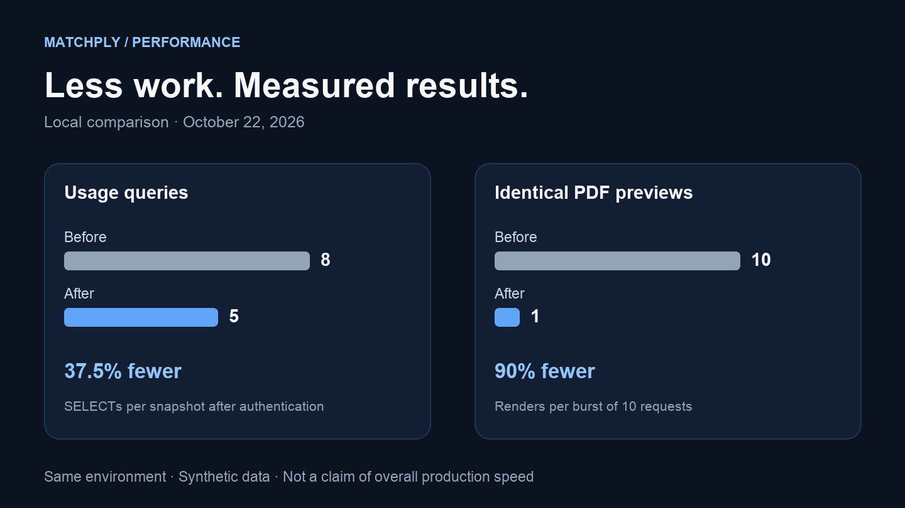

Matchply helps candidates tailor a CV with AI, track applications and generate PDF documents. As the product grows, so does the work behind each screen. In this iteration I looked for repeated work and compared the previous version with an optimized production build.

The clearest results were **eight queries reduced to five** when loading usage and CV access, and **one render for ten identical, simultaneous PDF previews**. That is 37.5% fewer SELECTs in that flow and 90% fewer renders in that particular burst. These numbers describe work avoided; full navigation includes other costs.

The implementation is on `codex-rendimiento-matchply`. These are laboratory measurements of the candidate build. **They do not describe live traffic or imply that this version has been deployed to matchply.com.**

## How I prepared the comparison

I used commit `d0dfcc2` as the baseline and the application code at `cbcab4a` as the candidate. Both production builds ran Next.js 14.2.35 with Node 20.20.2 and PostgreSQL 15. Each web container had a 1 GiB limit, a 768 MiB Node heap, eight database connections and two PDF workers.

The data was synthetic: three accounts with **10, 500 and 5,000 applications**, and **1, 20 and 100 CVs**, respectively. Both versions queried the same disposable database. No real users or CVs were involved.

For SQL I collected 200 samples per scenario and version, in two rounds of 100, ordered **before/after, after/before**. For browser navigation I collected 30 samples per condition and version on the large account, also counterbalancing version order. Chromium used a 390 × 844 viewport, 150 ms network latency, 10 MiBits/s download throughput and fourfold CPU throttling.

Cold navigation cleared the browser HTTP cache while keeping the server warm. Repeated navigation retained browser assets. Timing ran from navigation start until the test observed the first visible application, including automation observation overhead. **This is not LCP or INP.**

## Usage: resolve the plan context once

The usage endpoint called several readers that independently loaded the user and plan. Each helper was doing its job, but the combined request repeated reads.

I now resolve the plan context once per request and pass it to the usage and CV-access readers. Small trial metadata comes from that same read. This adds no global cache of permissions or personal information.

| Synthetic account | SELECTs before → after | Median before → after |
| --- | --- | --- |
| 10 applications / 1 CV | 8 → 5 | 0.747 → 0.623 ms |
| 500 applications / 20 CVs | 8 → 5 | 0.613 → 0.562 ms |
| 5,000 applications / 100 CVs | 8 → 5 | 0.653 → 0.600 ms |

These are SQL/JavaScript timings **after authentication**, with a warm database and connection pool. They are not HTTP response times. Removing three reads is consistent; the absolute time difference is small in this environment. The downloadable data includes every sample and the higher percentiles, including their variation.

I also replaced repeated CV searches with `Map` and `Set`, preserving ordering and selection rules.

## PDF: share the render already in progress

PDF caching already existed. The gap was between starting a render and placing its result in the cache. Several requests arriving during that interval all saw a miss and independently generated the same document.

A pending-promise map, keyed by a hash of the document and its options, now shares that generation. The entry is removed on both success and failure, allowing retries after an error.

I tested three bursts of ten simultaneous requests per version. Every burst used a new ten-page synthetic document; the paired versions received exactly the same body. Workers were warmed first and the real rate limits remained enabled.

Logs confirmed **30 renders before and three after** across the three bursts. In each candidate burst, nine requests shared the generation started by the first. None was served from a previously cached result.

| Burst | Renders before → after | Time to complete all 10 responses |
| --- | --- | --- |
| 1 | 10 → 1 | 425 → 122 ms |
| 2 | 10 → 1 | 331 → 94 ms |
| 3 | 10 → 1 | 315 → 75 ms |

All ten responses in each burst returned HTTP 200, a PDF signature and a ten-page header. Shared candidate responses were byte-identical. Three bursts demonstrate this scenario; they do not establish sustained latency or a production percentile.

Authorization, quotas, auditing and export persistence still run per request. Only rendering is shared. The worker timeout now includes queue waiting, so an expired job cannot start consuming CPU after its deadline.

## Navigation: reporting what barely changes

| Browser cache | p50 before → after | p95 before → after |
| --- | --- | --- |
| Cold | 1,653.4 → 1,604.6 ms | 1,673.4 → 1,700.6 ms |
| Repeated | 419.6 → 429.9 ms | 463.1 → 466.9 ms |

Cold-navigation median decreased by about 3%, while its p95 increased. With cached assets, both values increased slightly. This did not demonstrate a consistent navigation improvement across conditions. The main result is less work in specific paths; a blanket percentage speedup for the entire application would overstate the evidence.

This focused test complements the earlier 90-case run per version across the dashboard, active and archived applications, companies, contacts, settings and editor, with different account sizes and devices. That run had three samples per case, useful for identifying signals to investigate, not promising a production percentile.

Next's estimated First Load JS changed from 188 to 186 kB for Applications and from 264 to 263 kB for the editor. My CVs remained at 192 kB. Those are small build-estimate changes, separate from bytes transferred during an actual visit.

## Work removed from the background

I also found a thumbnail queue bug: the third task could receive a promise already resolved with an empty string while waiting for one of two execution slots. Each task now keeps one stable promise from queue admission to completion. I retained maximum concurrency of two, deduplication and subscriber cancellation, with regression tests for three tasks, aborts and retries.

The editor now calculates document differences only when comparison is visible, preserving the algorithm and output. Replaced previews are aborted, and only the current request may publish pages or errors.

Research polling waits for the previous request to finish before scheduling another, and stops on completion or unmount. Concurrent usage requests coalesce; an invalidation during a read triggers a fresh read afterward. The debug modal loads when opened.

For AI jobs I separated small progress and publication-guard projections from the full documents workers need. Progress reads use the transaction they receive, avoiding another connection acquisition while locks are held. This reduces reads and pool pressure; it does not measure faster AI-model responses.

## Checking that behavior still works

Verification included typecheck, lint, a production build, **438 base tests**, **141 PostgreSQL integrations**, eight browser tests and nine deployment-operator tests. Dedicated migration, HTTP and single-connection optimization profiles also ran. Some tests overlap between profiles, so I do not add them together as unique cases.

Checks cover isolation between users, guests and plans, saving and variants, photos, 1/3/10-page documents, quotas, AI leases and retries. The optimization suite completed with the connection pool limited to one. Required integration suites now fail when missing configuration would cause them to be skipped.

There are no new migrations or schema changes. Rolling back this iteration uses an application version, without restoring data.

## Data and limits

Measurements were taken on **October 22, 2026**, in Docker on an aarch64 host. The VM had 10 CPUs and approximately 7.75 GiB of RAM. Both web containers kept equal limits, and measurements ran sequentially with no parallel builds.

The lab does not reproduce VPS traffic, the full production data distribution or sustained multiuser load. Thirty navigations describe this run; they do not guarantee an SLO. There are no field LCP/INP measurements or claims about AI-provider response time.

- [Results and raw samples](/benchmarks/matchply-2026-10-22/results.json).
- [Methodology and reproduction commands](/benchmarks/matchply-2026-10-22/README.txt) (Spanish).
- [Implementation and tests on GitHub](https://github.com/angelporlan/Matchply/tree/codex-rendimiento-matchply).

This iteration left fewer reads, fewer duplicate renders and more demanding regression checks. The next evaluation is to compare those results with real metrics when the candidate version is deployed.
