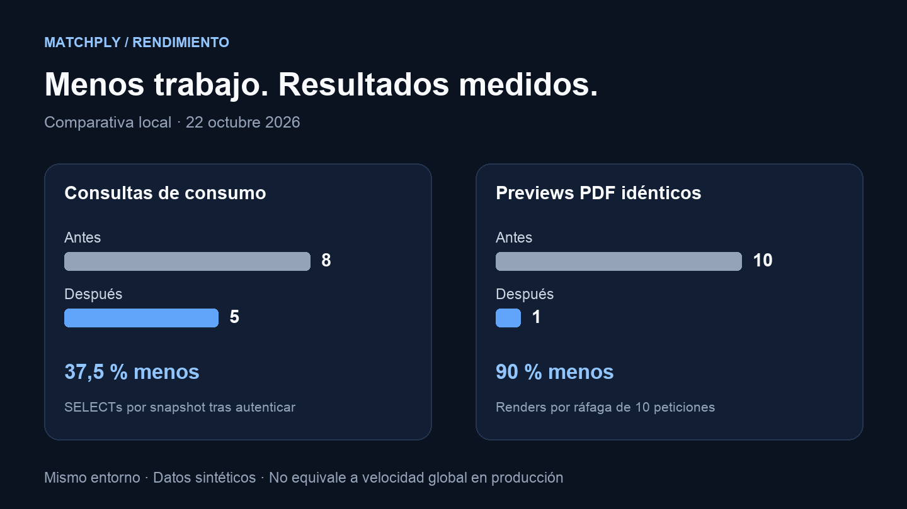

Matchply permite adaptar un CV con IA, seguir candidaturas y generar documentos PDF. A medida que crece el producto, también crece el trabajo que hace cada pantalla. En esta iteración revisé dónde se repetía ese trabajo y comparé la versión anterior con una build optimizada.

Los resultados más claros fueron **ocho consultas reducidas a cinco** para obtener el estado de consumo y acceso a CVs, y **un único render para diez previews PDF idénticos y simultáneos**. Eso equivale a un 37,5 % menos de SELECTs en ese flujo y un 90 % menos de renders en esa ráfaga concreta. Esas cifras describen trabajo evitado; la navegación completa tiene otros costes.

La implementación está en la rama `codex-rendimiento-matchply`. Las mediciones de este artículo corresponden al laboratorio y a esa build candidata; **no son mediciones del tráfico real ni implican que los cambios estén desplegados en matchply.com**.

## Cómo preparé la comparación

Usé como referencia el commit `d0dfcc2` y como candidato el código de aplicación de `cbcab4a`. Ambas builds ejecutaron Next.js 14.2.35 con Node 20.20.2 y PostgreSQL 15. Cada contenedor web tuvo el mismo límite de 1 GiB, un heap de 768 MiB, un pool de ocho conexiones y dos workers PDF.

Los datos eran sintéticos: tres cuentas con **10, 500 y 5.000 candidaturas**, y **1, 20 y 100 CVs** respectivamente. Las dos versiones consultaron la misma base desechable. No usé CVs ni datos de usuarios reales.

Para las consultas repetí cada escenario 200 veces por versión, repartidas en dos rondas de 100 y con orden **antes/después, después/antes**. Para el navegador repetí 30 veces cada condición en la cuenta grande, también alternando el orden de las versiones. Medí Candidaturas en Chromium con una pantalla de 390 × 844, 150 ms de latencia, 10 MiBits/s de descarga y CPU ralentizada cuatro veces.

En las cargas frías vacié la caché HTTP del navegador; el servidor permaneció caliente. En las repetidas conservé los recursos del navegador. El tiempo registrado va desde el inicio de navegación hasta observar la primera candidatura visible. Incluye el coste de observación del test: **no es LCP ni INP**.

## Consumo: resolver el contexto una sola vez

El endpoint de consumo necesitaba consultar el usuario y su plan desde varios lectores. Cada helper hacía correctamente su trabajo, pero juntos repetían lecturas.

La solución fue resolver un contexto de plan una vez por petición y pasarlo a los lectores de consumo y acceso a CV. Los datos pequeños del trial viajan en esa misma lectura. No añadí una caché global de permisos ni de datos personales.

| Cuenta sintética | SELECTs antes → después | Mediana antes → después |
| --- | --- | --- |
| 10 candidaturas / 1 CV | 8 → 5 | 0,747 → 0,623 ms |
| 500 candidaturas / 20 CVs | 8 → 5 | 0,613 → 0,562 ms |
| 5.000 candidaturas / 100 CVs | 8 → 5 | 0,653 → 0,600 ms |

Estos tiempos miden el trabajo SQL/JavaScript **después de autenticar**, con conexiones y base calientes. No son tiempos HTTP. La reducción de tres lecturas es estable; la diferencia absoluta de tiempo es pequeña en este laboratorio. Las muestras completas, incluidos los percentiles altos y sus variaciones, están al final del artículo.

También sustituí búsquedas repetidas de CVs por `Map` y `Set`, conservando el orden y las reglas de selección.

## PDF: compartir el render que ya está en curso

La caché de PDFs ya existía. El problema aparecía cuando llegaban varias peticiones del mismo documento antes de que terminara el primer render: ninguna encontraba todavía una entrada y todas empezaban a generarlo.

Ahora una tabla de promesas pendientes, identificadas por el hash del contenido y sus opciones, permite compartir esa generación. La entrada desaparece tanto si termina correctamente como si falla, de modo que un error permite reintentar.

Para comprobarlo envié tres ráfagas de diez peticiones simultáneas por versión. Cada ráfaga utilizó un documento sintético de diez páginas con un hash nuevo. Los workers se calentaron antes y se mantuvieron los límites reales de peticiones.

Los logs confirmaron **30 renders frente a tres**, sumando las tres ráfagas. En cada una, nueve peticiones del candidato compartieron la generación iniciada por la primera. Ninguna respuesta se sirvió desde una entrada de caché previa.

| Ráfaga | Renders antes → después | Tiempo de completar las 10 respuestas |
| --- | --- | --- |
| 1 | 10 → 1 | 425 → 122 ms |
| 2 | 10 → 1 | 331 → 94 ms |
| 3 | 10 → 1 | 315 → 75 ms |

Se recibieron las diez respuestas de cada ráfaga, con estado 200, firma PDF y cabecera de diez páginas. Las respuestas compartidas del candidato eran idénticas byte por byte. Son solo tres ráfagas: muestran el coste del duplicado en este escenario, sin acreditar una latencia sostenida o un percentil de producción.

La autorización, las cuotas, la auditoría y la persistencia de exportaciones siguen siendo responsabilidad de cada petición. Solo se comparte el trabajo de renderizado. Además, el timeout del worker ahora incluye el tiempo esperando en cola, evitando que una tarea ya vencida empiece a consumir CPU.

## Navegación: también medí lo que apenas cambia

| Caché del navegador | p50 antes → después | p95 antes → después |
| --- | --- | --- |
| Fría | 1.653,4 → 1.604,6 ms | 1.673,4 → 1.700,6 ms |
| Repetida | 419,6 → 429,9 ms | 463,1 → 466,9 ms |

La mediana de la carga fría bajó aproximadamente un 3 %, pero su p95 subió. Con caché repetida, ambos valores subieron ligeramente. No medí una mejora consistente de navegación en todas las condiciones. Por eso el resultado principal de esta iteración es el trabajo eliminado en rutas concretas; sería exagerado decir que toda la aplicación es un porcentaje más rápida.

Esta prueba focal complementa el recorrido anterior de 90 casos por versión: dashboard, candidaturas activas y archivadas, empresas, contactos, ajustes y editor, con distintos tamaños de cuenta y dispositivos. Aquel recorrido tenía tres muestras por caso y servía para detectar señales que investigar, no para prometer un percentil de producción.

El tamaño estimado por la build de Next pasó de 188 a 186 kB de First Load JS en Candidaturas, y de 264 a 263 kB en el editor. Mis CVs se mantuvo en 192 kB. Son cambios pequeños y estimaciones de la build, distintas de los bytes realmente transferidos en cada visita.

## El trabajo que dejé de hacer en segundo plano

Encontré además un fallo en la cola de miniaturas: la tercera tarea podía recibir una promesa ya resuelta con una cadena vacía mientras esperaba a que quedara libre uno de los dos puestos de ejecución. Cada tarea mantiene ahora una promesa estable desde que entra en cola. Conservé la concurrencia máxima de dos, la deduplicación y la cancelación por suscriptor, y añadí pruebas para tres tareas, abortos y reintentos.

En el editor, el cálculo de diferencias entre documentos solo se ejecuta al mostrar la comparación. Su algoritmo y su resultado se conservan. Las previews reemplazadas se abortan y solo la petición vigente puede publicar páginas o errores.

El polling de investigación espera a que acabe la consulta anterior antes de programar la siguiente, y se detiene al finalizar o desmontar. Las consultas simultáneas de consumo se agrupan; si hay una invalidación durante la lectura, se solicita después el estado actualizado. El modal de depuración se carga al abrirlo.

En los jobs de IA separé las lecturas pequeñas de progreso y los guards de publicación de las cargas completas que necesitan los workers. Las lecturas de progreso usan la transacción recibida. Esto evita solicitar otra conexión mientras la operación retiene locks. No he medido aquí una aceleración del modelo de IA: el cambio reduce lecturas y presión sobre el pool.

## Cómo comprobé que las funciones seguían funcionando

La verificación incluyó typecheck, lint, build de producción, **438 pruebas base**, **141 integraciones con PostgreSQL**, ocho pruebas de navegador y nueve del operador de despliegue. También se ejecutaron los perfiles específicos de migración, HTTP y optimización con una sola conexión. Algunas pruebas se repiten entre perfiles; no las sumo como si fueran casos únicos.

Las comprobaciones cubren permisos entre usuarios, invitados y planes, guardado y variantes, fotos, documentos de 1, 3 y 10 páginas, cuotas, leases y reintentos de IA. La suite de optimización terminó con el pool limitado a una conexión. Las integraciones obligatorias ahora fallan si se omiten por falta de configuración.

No añadí migraciones ni cambié el esquema. La reversión de esta iteración se hace por versión de aplicación, sin restaurar datos.

## Datos y límites de la prueba

Las mediciones se hicieron el **22 de octubre de 2026**, en Docker sobre una máquina aarch64. La VM disponía de 10 CPUs y aproximadamente 7,75 GiB de memoria. Los dos contenedores conservaron límites iguales y las mediciones se ejecutaron de forma secuencial, sin builds en paralelo.

El laboratorio no reproduce el tráfico del VPS, la distribución completa de datos ni una carga sostenida de muchos usuarios. Treinta navegaciones permiten describir esta ejecución, no garantizar un SLO. No he medido LCP/INP de campo ni una reducción del tiempo que tarda un proveedor de IA en responder.

- [Resultados y muestras brutas de la comparación](/benchmarks/matchply-2026-10-22/results.json).
- [Metodología y comandos de reproducción](/benchmarks/matchply-2026-10-22/README.txt).
- [Código y pruebas de la iteración en GitHub](https://github.com/angelporlan/Matchply/tree/codex-rendimiento-matchply).

Lo que me llevo de esta iteración es una forma concreta de avanzar: identificar trabajo repetido, eliminarlo con cambios pequeños y comprobar tanto el coste como el comportamiento. En Matchply eso ha dejado menos lecturas, menos renders duplicados y una base de pruebas más exigente. La siguiente evaluación será contrastarlo con métricas reales cuando se despliegue esta versión.
